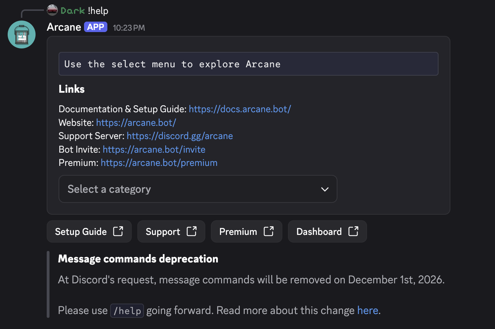

# Message command deprecation

::: tip Short version
**Discord** is forcing bots to remove message commands (the prefix ones like `!rank`). You can keep using message commands until **December 1st**, when they will be removed and stop responding. Please start using slash commands (`/rank`) and make sure your server permissions are set up correctly (`Use Application Commands`).
:::

## What’s changing

| | Message / prefix commands | Slash commands |
| - | - | - |
| Example | `!level`, `!ban` | `/level`, `/ban` |
| Right now | Deprecated. They still work, but you’ll get warnings to migrate | What Discord wants going forward |
| **December 1st** | Message commands **stop responding** | **No change** |
| Custom commands | **No change** | **No change** |

Arcane’s built-in commands need to be slash-only after December 1st. Your custom commands are the exception and will still support message commands.

### Making the switch

::: tip
Members need the `Use Application Commands` permission to use slash commands.
:::

Using slash commands is simple:

1. In a channel where Arcane can run, type `/`.
2. Start typing the name of the command you used to run with a prefix (`level`, `ban`, `role`, and so on).
3. Pick the command that shows up under **Arcane** (look for the Arcane logo so you don’t grab another bot’s command by mistake).
4. Fill in whatever options Discord asks for, then send it.

<video controls="controls" src="/images/commands/slash-commands.mp4" />

### Timeline

| When | What happened |
| - | - |
| **August 2021** | We started rolling out slash commands and warning that Discord wanted bots on `/`. |
| **February 2022** | Arcane went slash-only. Message/prefix commands were removed. |
| **After that** | Discord’s guidance said offering slash ***and*** message commands was okay. |
| **January 2025** | We added message commands back so people who preferred prefixes could use them again alongside slash commands. |
| **Now** | Discord is reversing course. Message commands are **deprecated**. They still work, but you’ll be warned to migrate. |
| **December 1st, 2026** | Message commands will **stop responding**. Arcane will be slash-only again. |

## FAQ

### What if I'm already using slash commands?

That's great! Over 70% of Arcane users already use slash commands. You don't need to do anything.

### I don’t see slash commands

Make sure:

- Your app is up to date (especially mobile apps on Android and iOS)
- Members have the `Use Application Commands` permission
- No restrictions have been set up. See [here](/core/commands/settings#restricting-command-access)

### Will my custom commands break?

No. Custom commands will continue supporting both message commands **and** slash commands. Only Arcane's built-in commands must be migrated to slash commands.

### Why can’t you keep prefixes and slash forever?

Discord makes bots **re-apply every year** to keep **message content** access, and **they won’t approve** that access if we still offer message commands. If that access goes away, we don’t only lose `!` commands, but we also lose **delete/edit message logs**, **automod**, leveling extras like **effort boosters**, and more.

### Why remove message commands years ago, bring them back, then remove them again?

See [timeline](#timeline). Discord has changed their policies and we are required to follow them.

### Is this permanent?

Yes. This applies not only to Arcane, but every bot on Discord.

### I have another question

Please reach out in our [support server](https://discord.gg/arcane) (please use `#help-me`).
